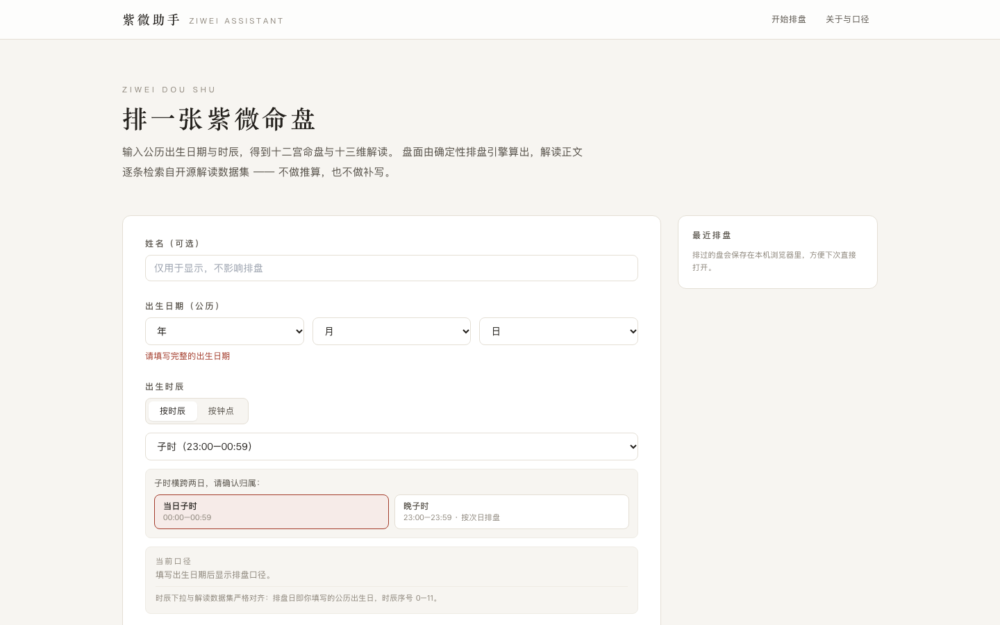
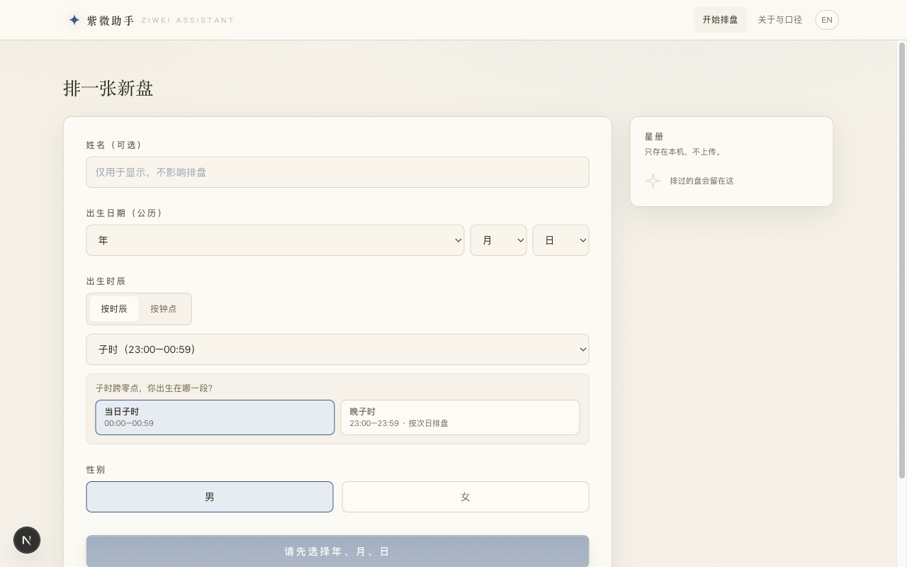
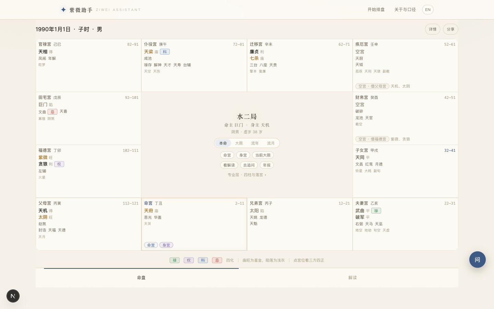
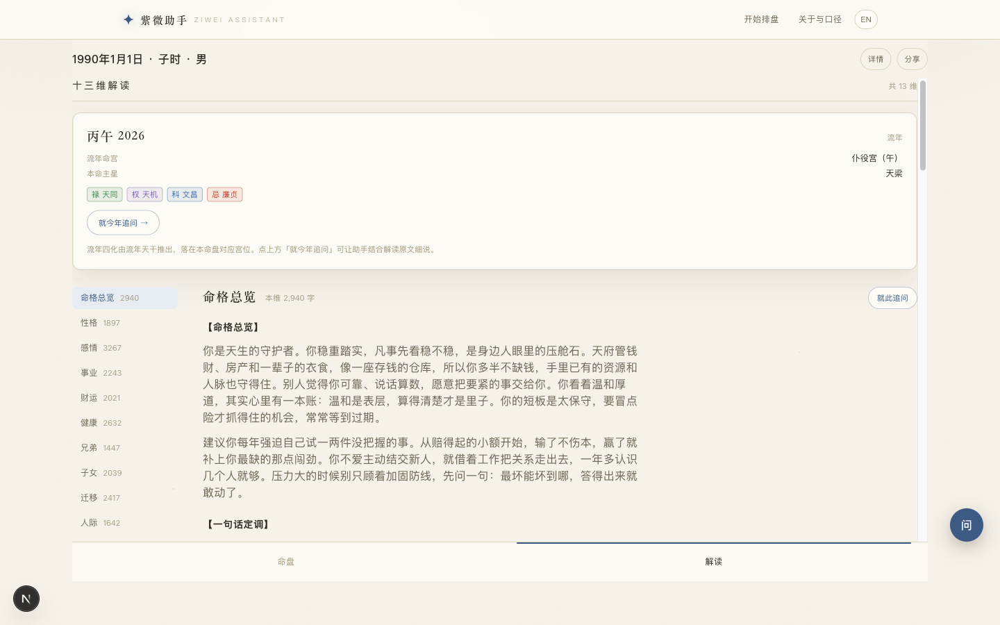

# Ziwei Assistant (紫微助手)

**Deterministic Zi Wei Dou Shu (紫微斗数) charting → 12-palace board → 13-dimension grounded readings → local chart library → multi-turn chart-grounded chat.**

**确定性排盘 → 12 宫命盘 → 基于数据集的 13 维解读 → 命盘本地存档 → 立足盘面的多轮追问。**

**Live demo: <https://ziwei.secondplanet.cc>** — free, no sign-up. The built-in AI gives every visitor 3 free follow-up questions per day (UTC); bring your own API key for unlimited use.
**在线体验** —— 免费、无需注册；内置 AI 每天 3 次免费追问（按 UTC 日切），自带 Key 不限量。

[](https://github.com/frankfika/ziwei/actions/workflows/ci.yml)
[](LICENSE)
[](https://github.com/Renhuai123/ziwei-doushu)
[](https://github.com/frankfika/ziwei/releases)

> **This is NOT "yet another Ziwei LLM".** Charting is pure deterministic computation done by
> the program; reading text is retrieved on demand from a large pre-generated open dataset;
> the LLM only powers the optional follow-up Q&A — under strict grounding constraints.
>
> **不是「再训一个紫微大模型」项目。** 排盘是确定性计算，解读正文来自预生成数据集检索，模型只负责可选的追问环节。

> **Disclaimer / 免责声明**：for cultural and educational interest only. Not medical, legal,
> financial, or life-decision advice.
> 本工具仅供文化兴趣与学习之用，不构成任何医疗、法律、投资或人生决策建议。

---

## Highlights | 功能一览

| | |
|---|---|
| **Deterministic charting** | The board is computed by a vendored open-source engine (MIT) — no LLM ever lays stars or guesses palaces. Leap months, late Zi hour (晚子时), and 五行局 are handled by the engine, not by prompts. **排盘只走确定性引擎**，闰月、晚子时、五行局都由引擎处理。 |
| **Grounded readings** | 13-dimension texts (命宫, 兄弟, 夫妻, 子女, 财帛, 疾厄, 迁移, 交友, 事业, 田宅, 福德, 父母, 身宫) come from a dataset of **674,976 pre-written charts (1950–2026)**. If a year isn't loaded, the UI says so — it never invents content. **解读只从数据集检索**，没覆盖的年份如实提示，不编内容。 |
| **Grounded follow-up chat** | Multi-turn conversation anchored to a specific chart. The model may only use engine-produced chart facts + retrieved dataset text; a mechanical self-check (palace-placement check + reference star table) flags out-of-bounds content after every answer. **追问立足盘面 + 原文**，机械自检拦截越界内容。 |
| **Local-first privacy** | Chart library and every conversation live in your browser's `localStorage` — nothing is uploaded. Per-chart threads (ChatGPT-style), rename/delete charts, delete conversations — all local. **命盘库与对话只存本机**，可改名、删除。 |
| **Bilingual UI** | Full 中文 / English switch; chart terminology stays faithful in both languages. **全站中英双语**。 |
| **Ancient star-atlas design** | Rice-paper canvas, indigo/vermilion/gilt palette, hand-drawn SVG star map, serif display type — modeled on classical star charts (钦天监图谱), not a dark "astrology app". **古星图视觉**：宣纸底、黛青朱砂鎏金、手绘星官图。 |
| **Three interfaces** | Web (Next.js 16), CLI, and a pluggable-LLM ask module — one shared service layer. **Web / 命令行 / 可插拔追问模块**三端共用服务层。 |
| **Small deploy footprint** | The 53 GB raw dataset compresses to **1.5 GB** in compact form; the byte-offset index is only **15 MB**. **compact 形态 1.5GB 部署**，索引仅 15MB。 |

---

## Screenshots | 界面预览

**Home — a hand-drawn Ziwei star map hero: three ring-walls, twelve earthly-branch ticks, the Northern Dipper, one 120-second revolution, vertical serif title, vermilion seal.
首页是一张紫微垣星图**：三重环垣、十二地支刻度、北斗七星官，120 秒缓转，竖排宋体 + 朱砂钤印。



**Cast a chart: Gregorian date + hour (or clock time) + gender. The chart library is kept locally.**
**排一张盘：公历生日 + 时辰/钟点 + 性别，星册自动存在本机。**



**12-palace board — palaces fade in one by one from the Life Palace when the chart opens.**
**12 宫命盘：排盘完成时十二宫自命宫起依次浮现。**



**13-dimension reading (retrieved verbatim from the open dataset, not generated).**
**13 维解读（正文来自开源数据集检索，非模型生成）。**



> Screenshots use public test data (1990-01-01, Zi hour, male). The UI is original work —
> no membership, payment, anti-abuse, or SEO farm features from upstream commercial sites.
> 截图用的是公开测试数据；界面为自研，不含上游商业站的会员/支付/防刷/SEO 功能。

### Visual language: the ancient star atlas | 视觉与动效：古星图

The interface borrows its vocabulary from **classical Chinese star charts and imperial observatory
atlases**, not the usual dark-space astrology look:

| Element | Approach | 元素 | 做法 |
|---|---|---|---|
| Paper | Rice-paper base `#F6F2E9` + fixed grain noise / top skylight / bottom warm shadow | 纸面 | 宣纸底 + 三层光 |
| Palette | Indigo `#3D5A85` (interaction), gilt `#A8792F` (palaces & ritual), vermilion `#C1402F` (four transformations & seals) | 主色 | 黛青交互、鎏金宫位、朱砂四化钤印 |
| Type | Song/serif for titles, bureau names, and the Life Master; sans for body text | 字体 | 标题宋体、正文黑体 |
| Star map | Hand-drawn SVG with twelve branch inscriptions and polar crosshairs; orientation matches the chart page (子 at top, 卯 left, 酉 right) | 星图 | 手绘 SVG 星官图，方位与命盘一致 |
| Light | Gilt breathing glow on the selected palace, faint gilt ring on the Life Palace, indigo tint on the trine/quincunx — three layers, each with one job | 光 | 选中鎏金呼吸光、命宫常亮、三方四正黛青 tint |

Motion lands only on **ritual moments**, everything else stays still — all pure CSS, no animation library:

- **Opening ritual** — after casting, the twelve palaces fade in one by one around the branches (60 ms stagger, ~1.2 s total), corners seal, the center settles, a vermilion seal stamps.
  **开盘仪式**：十二宫自命宫起依次浮现，末了盖一方朱砂印。
- **Star-map revolution** — one turn per 120 s, slow enough to feel like drift.
  **星图缓转**：120 秒一圈。
- **Layered hover glow** — gilt outline on an independent `::before` layer so it never covers flow-year/decade markers.

`prefers-reduced-motion`: one-shot animations collapse to 80 ms, looping motion turns off entirely; printing freezes the final state without the seal.
`prefers-reduced-motion` 下一次性动效压到 80ms、循环动效关闭；打印定格终态且不渲染钤印。

---

## Quickstart (3 minutes) | 3 分钟跑起来

**Prerequisites**: Node.js ≥ 20.9 (Next.js 16 requirement), `zstd` (data decompression), ≥ 3 GB disk.

```bash
git clone https://github.com/frankfika/ziwei.git && cd ziwei

# ① Install dependencies / 装依赖
npm install

# ② Fetch reading data (from the upstream release, CC BY 4.0; ~2 MB per year compressed)
#    This grabs 3 sample years; for all 77 years see "Full-year coverage" below.
#    拉解读数据（上游 release，CC BY 4.0；单年压缩包约 2MB），这里取 3 年演示
scripts/download_data.sh --years 1990,2000,2020 --decompress 1990,2000,2020

# ③ Build the byte-offset index (seconds) / 建偏移索引（几秒）
npm run index:build -- --years 1990,2000,2020

# ④ Start the server / 起服务
npm run web:dev        # http://localhost:3000
```

Open <http://localhost:3000>, tap "去排一张盘" and enter a birth date — the board appears.

> **Everything works without any model API**: charting, the 12-palace board, and the 13-dimension
> readings are all local computation + local retrieval. Only follow-up Q&A needs a model, and
> years not covered by your loaded data are reported honestly, never fabricated.
> **不接任何模型 API 也能完整用**；数据没覆盖的年份如实提示，不会编内容补齐。

### Full-year coverage (1950–2026, 674,976 charts) | 全年覆盖

```bash
for y in $(seq 1950 2026); do scripts/download_data.sh --years $y --decompress $y; done
npm run index:build            # full index, ~3.5 min / 建全量索引
npm run data:compact -- --all  # compact form: 1.5 GB (replaces 53 GB raw) / 压成 1.5GB
# After compacting you may delete data/raw — queries prefer compact and only fall back to raw.
# 压完之后 data/raw 可以删掉 —— 查询优先走 compact，缺了才回退 raw
```

---

## Bring your own model (optional) | 接自己的模型（可选）

Only follow-up Q&A needs a model. The web app reads `apps/web/.env.local`
(**gitignored — never commit it**):

```bash
# apps/web/.env.local
ZIWEI_ASK_PROVIDER=openai
ZIWEI_ASK_BASE_URL=https://api.deepseek.com
ZIWEI_ASK_API_KEY=sk-your-key
ZIWEI_ASK_MODEL=deepseek-chat
ZIWEI_ASK_MAX_TOKENS=8000
```

The CLI/scripts use the same variables via the environment (see `deploy/.env.example`).
`ZIWEI_ASK_PROVIDER` supports `openai` (OpenAI-compatible: DeepSeek / Zhipu / MiniMax / vLLM / Ollama…),
`anthropic`, and `echo` (offline local stub for self-tests).

> ⚠️ **Don't default to a long-chain reasoning model**: its thinking tokens share the same
> `max_tokens` budget as the answer, so a long chain hits the provider's ~180 s timeout —
> symptoms: "spins for three minutes, then errors". Measured with the same prompt:
> MiniMax-M3 **281 s** (thinking consumed 11,967 / 12,496 tokens) vs. a light-thinking model
> **12 s** (397 tokens). Use fast non-reasoning defaults like `deepseek-chat`;
> MiniMax-M2.5 is verified in production (~17 s to first token).
> **思维链模型的思考 token 与正文共用 max_tokens 预算**，思考一长就撞 180s 超时。
> 推荐 `deepseek-chat` 这类快模型；MiniMax-M2.5 生产实测可用（首字约 17s）。

If nothing is configured, the UI says "AI not configured" — it never silently degrades and never
phones home. 不配置也不会静默降级、不会出网请求。

### Built-in daily quota | 内置追问额度

Visitors without their own key get **3 free follow-up questions per IP per day** (UTC midnight
rollover), overridable via `ZIWEI_ASK_DAILY_LIMIT`.

- A question is only counted when the request produces an answer; failures/interruptions are free.
  请求成功产出回答才扣次；失败/中断不扣。
- Exhausted → the API returns `QUOTA_EXCEEDED` and the UI shows a quota wall with traffic-pack
  entry points (20 / 100 / 500-question placeholder tiers).
  用尽后接口返回 `QUOTA_EXCEEDED`，界面弹额度墙并给「流量包」入口。
- **Payment is not wired** (stub): "buy" only records intent — no real transaction occurs.
  **支付尚未接通**（stub）：点「购买」只记录意向，不产生真实交易。
- Bring-your-own-key users are unlimited and not counted. 自带 Key 不限量、不计数。
- Quota copy (wall / exhausted notice / traffic packs) is bilingual, language stored locally.

---

## Architecture | 架构

```
[birth input: Gregorian date + hour + gender]
              ↓
      @ziwei/chart-engine          deterministic charting (vendored upstream engine, MIT)
              ↓  ChartJSON
      @ziwei/core                 application service layer (shared by all three fronts)
              ↓
      @ziwei/reading-index        offset-index retrieval → 13-dimension reading text
              ↓
      ┌──────────┬──────────┬──────────┐
      │ apps/web │ apps/cli │packages/ask│
      │ Next.js  │  CLI     │ optional Q&A│
      └──────────┴──────────┴──────────┘
```

### Four hard rules | 四条硬规则

1. **Charting runs only through the deterministic engine** — an LLM never computes a board or invents stars. **排盘只走确定性引擎**。
2. **Reading text is only retrieved from the dataset** — a model never writes a whole-chart reading from thin air. **解读正文只从数据集检索**。
3. **No fine-tuning by default** (no LoRA / full-parameter training / continued pretraining). **默认不做微调**。
4. **Retrieval keys match the dataset exactly**: `YYYY-MM-DD-hourIndex-gender`, hour index 0–11. **检索键与数据集严格一致**。

> The key semantics are **empirically verified, not copied from docs**: 15,400 samples across all
> 77 years (1950–2026) match direct charting **100%**. See `docs/KEY_SEMANTICS.md`.
> 键口径是实测确认的 —— 15,400 条样本跨全部 77 个年份 100% 直排匹配。

---

## Three ways to use it | 三种用法

### Web

```bash
npm run web:dev      # http://localhost:3000
```

| Route | What it is | 说明 |
|---|---|---|
| `/` | **Chat home**: star-map hero (no profiles yet) → pick a profile → chat; the panel header names the current chart; library & conversations are local only | **对话首页**：星图 hero → 选档案 → 追问；档案与对话只存本机 |
| `/new` | **Cast a chart**: date + hour/clock + gender + local chart library (rename / refill / delete) | **排盘表单** + 本机星册（改名 / 回填 / 删除） |
| `/chart?y=&m=&d=&h=&g=` | 12-palace board (compact tappable grid on mobile) + 13-dimension reading + conversational Q&A + late-Zi notice | 12 宫盘面 + 13 维解读 + 会话式追问 + 晚子时提示 |
| `/synastry` | Synastry: two charts side by side | 双人合盘（两张盘对照） |
| `/about` | Key semantics, coverage, attribution, disclaimer | 口径说明、覆盖情况、署名与免责声明 |

Charting runs in a **Server Action** (the charting engine never ships to the browser bundle).
排盘在 Server Action 里算，排盘引擎不进客户端包。

### CLI | 命令行

```bash
npm run chart -- chart --date 1990-01-01 --hour 0 --gender male   # board only
npm run chart -- read  --date 1990-01-01 --hour 0 --gender male   # board + 13-dim reading
npm run chart -- read  --date 1990-01-01 --hour 0 --gender male --dim love
npm run chart -- coverage                                         # dataset coverage
npm run chart -- ask   --date 1990-01-01 --hour 0 --gender male --question "How is this year?"
npm run chart -- help                                             # full flag table
```

| Subcommand | Purpose |
|---|---|
| `chart` | Cast and print a 12-palace summary |
| `read` | Cast + 13-dimension reading (200-char preview per dimension by default; `--full` prints everything) |
| `ask` | Chart-grounded follow-up (requires provider env vars) |
| `coverage` | Which years the dataset covers |

| Flag | Meaning |
|---|---|
| `--date` | Gregorian birth date `YYYY-MM-DD` |
| `--hour` | Hour index 0–11, **or** Chinese `子丑寅…` |
| `--clock` | Clock time instead of index (`--clock 23:30` → late Zi counts as next day) |
| `--gender` | `male`/`female`, or `男`/`女`/`m`/`f` |
| `--name` | Display name |
| `--dim` | One dimension only (`love` or `感情`, `read` only) |
| `--question` | The question (`ask` only) |
| `--full` | `read` prints all 13 dimensions in full |
| `--json` | Machine-readable output |

Exit codes: `0` success / `2` bad arguments / `3` year not covered by dataset / `1` other.
退出码：`0` 成功 / `2` 参数错误 / `3` 样本库未覆盖 / `1` 其他。

### Follow-up Q&A (optional) | 追问（可选）

Follow-ups are **multi-turn conversations**: each chart gets its own thread list (new / switch /
delete), stored in the browser's `localStorage` (never uploaded). Later questions automatically
carry recent turns as context so the model understands references; answers are required to be
plain language with no internal annotation labels.

追问是**多轮会话**：每张盘下有多条对话，可新建、切换、删除，存浏览器本机不上传；
后续问题自动带上文；回答要求大白话。

Hard constraints: the model may only use engine-produced chart facts + retrieved dataset text;
anything the material doesn't cover must be answered with "the material doesn't say". Every answer
then passes a **mechanical self-check** (palace-placement check + reference star table), and
out-of-bounds content gets flagged in the UI. 材料没写的必须直说「没有」；机械自检标出越界内容。

---

## Project layout | 目录结构

```
ziwei-assistant/
├── packages/
│   ├── chart-engine/      charting engine (vendored upstream MIT) + chart() adapter + ChartJSON contract
│   ├── reading-index/     dataset byte-offset index: build, query, key semantics, compact form
│   ├── core/              application service layer: ZiweiService (shared by Web / CLI / ask)
│   ├── citation-guard/    Ni Shi's 《天纪》 citation detection and degradation
│   └── ask/               optional follow-up Q&A: pluggable LLM providers + anti-hallucination check
├── apps/
│   ├── web/               Next.js 16 + React 19 UI
│   └── cli/               command-line tool
├── tests/                 regression suite + golden-chart snapshots
├── scripts/
│   └── download_data.sh   dataset download / decompression
├── deploy/                single-machine Docker deployment (image build, compose, ops notes)
├── docs/
│   ├── ARCHITECTURE.md    architecture contract (read before contributing)
│   ├── KEY_SEMANTICS.md   key semantics and charting rules
│   ├── DATA.md            data operations manual
│   ├── DEPLOY.md          deployment guide
│   └── LEGAL_NOTES.md     legal notes and citation handling
├── vendor/upstream-reference/   upstream MIT reference (read-only)
├── ATTRIBUTION.md         attribution and licensing (a legal obligation)
└── data/                  dataset (gitignored — large files stay out of git)
```

---

## Data | 数据

Reading dataset v4.0-13d: **674,976 charts × 13 dimensions, 1950–2026**.

| Directory | Contents | Size |
|---|---|---|
| `data/zst/` | 77 compressed archives | 164 MB |
| `data/raw/` | 77 decompressed JSONL files | 53 GB |
| `data/compact/` | 77 compact-form files (recommended) | **1.5 GB** |
| `data/index/` | 77 byte-offset indexes | **15 MB** |

The index uses **byte offsets** — 15 MB total against 53 GB of source; queries `seek` straight to
the row. The compact form compresses another **34×**, so production deploys need only 1.5 GB.
Details in `docs/DATA.md`.
索引采用字节偏移方案（15MB 对 53GB），compact 再压 34 倍，部署只需 1.5GB。

---

## Development | 开发

```bash
npm run typecheck     # typecheck the whole repo (packages + apps + tests)
npm test              # regression suite (96 cases, incl. golden charts & key-semantics proof)
npm run acceptance    # full acceptance: typecheck + test + CLI end-to-end + web build (24 items)
npm run index:build   # build the index
npm run data:compact  # build compact form
npm run chart -- chart --date 1990-01-01 --hour 0 --gender male   # CLI
npm run web:dev       # web dev server
npm run web:build     # web production build
npm run ask:selftest  # ask-module self-test (zero network)
npm run citation:selftest  # citation-degradation self-test (25 cases, real-data regression)
```

Single-machine Docker deployment: see [`docs/DEPLOY.md`](docs/DEPLOY.md).

```bash
npm run docker:build  # build image (dataset stays out; mounted as a volume)
npm run docker:up     # start
npm run docker:logs   # logs
npm run docker:down   # stop
```

The suite includes **golden-chart snapshots** (9 charts covering leap day / leap month / year-end /
hour boundaries / both genders / first-and-last dataset years): a silent engine change makes the
tests point at the exact JSON path that moved.

```bash
npm test
# ✗ 金标准盘被改动了：2000-02-29-h06-male（闰年 2 月 29 日 · 午时 · 男）
#   共 3 处差异：
#     · $.mingGongFirstMajorStar   快照: "紫微"   重算: "天同"
#     · $.wuxingJuName             快照: "木三局"  重算: "水二局"
```

Refresh snapshots (only after confirming the change is **intentional**), then review `git diff`
before committing: `ZIWEI_UPDATE_GOLDEN=1 npm test`.

CI: `.github/workflows/ci.yml` (push / PR → install → typecheck → test). CI has no 56 GB dataset,
so data-dependent cases **skip themselves with an explanation** while pure-engine cases run.

---

## Troubleshooting | 排障

| Symptom | Likely cause | Fix |
|---|---|---|
| UI says "year not covered" | that year's index is missing | `npm run index:build` (or fetch that year's data) |
| `npm run web:dev` won't start / port busy | 3000 taken | `PORT=3001 npm run web:dev` |
| Q&A panel says "AI not configured" | no provider | fill in `apps/web/.env.local` (see above) |
| Q&A spins for minutes then times out | long-chain reasoning model ate the token budget | switch to a fast model (`deepseek-chat` class) |
| data decompression fails | zstd long window | must use `zstd -d --long=27` (the script already does) |
| out of disk | full decompression needs 53 GB | `npm run data:compact -- --all`, then delete `data/raw` |

---

## Known limitations | 已知边界

| Item | Status |
|---|---|
| Data coverage | **Full 1950–2026** (all 674,976 entries queryable); re-laying instructions in `docs/DATA.md` §4.3 |
| True solar time / DST | **Not done** (the dataset doesn't do them; adding them would misalign retrieval keys). A separate future effort |
| Ni Shi's 《天纪》 citations | Dense in the dataset (79% of dimension texts contain restricted citation fragments). Detection + degradation tooling provided; must be handled before commercialization — `docs/LEGAL_NOTES.md` |
| Leap month / brightness school | Engine fixed to `split` (mid-month boundary) + full-book brightness table, matching dataset generation |
| Leap-month flag | `isLeapMonth` is **always false** under `split` — leap months manifest as lunar-month assignment; don't use it to detect leap months |
| Chart caching | `currentAge` changes daily → the whole `ChartJSON` is **not cacheable** |
| Out-of-chart star detection | the engine places all 70 stars on every chart (palace assignment differs), so set checks almost never fire; anti-hallucination relies on the **palace-placement check** + reference star table |
| Q&A module | No real API wired by default (configure provider env vars); built-in AI 3/IP/day (`ZIWEI_ASK_DAILY_LIMIT` overridable), with placeholder traffic packs after exhaustion |
| Q&A output | **Streaming**: tokens render as they arrive (SSE); chain-of-thought is never exposed |
| UI motion | Pure CSS, no animation library; `prefers-reduced-motion` honored; printing freezes final state |
| Local storage | Library + conversations in `localStorage` only; ≤ 50 charts; ≤ 50 messages kept per conversation (oldest trimmed, UI notes the truncation) |
| Upstream commercial features | Deliberately **not** implemented: membership / payment / anti-abuse / SEO farms |

---

## Attribution & License | 署名与许可

**The following attribution must be preserved** (legal obligation — see `ATTRIBUTION.md`):

```
This project uses the "Ziwei Doushu Open Reading Dataset v4.0"
(674,976 charts × 13 dimensions) and the open-source charting engine.
Source: https://github.com/Renhuai123/ziwei-doushu
Author: 王多鱼AI
Dataset license: CC BY 4.0; engine code: MIT.
```

```
本项目使用了「紫微斗数开源解读数据集 v4.0」（674,976 张命盘 × 13 维）
以及开源排盘引擎。
来源：https://github.com/Renhuai123/ziwei-doushu
作者：王多鱼AI
数据集许可：CC BY 4.0；引擎代码：MIT。
```

Upstream repository: <https://github.com/Renhuai123/ziwei-doushu>
